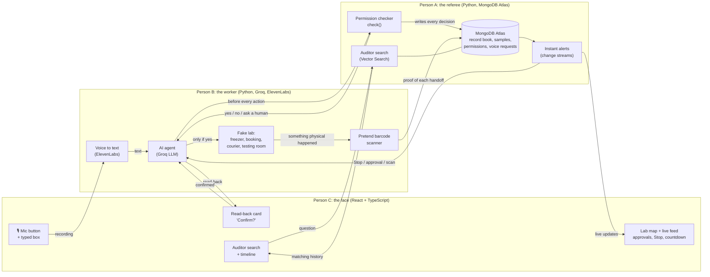

# Team breakdown: who builds what

Three people, one day. This page explains each person's part in plain words. The technical details for each part are in `ARCHITECTURE.md`, `DATA_MODEL.md` and `BUILD_PLAN.md`.

## The big picture

**How to read it:** the tech speaks into Person C's mic button. Person B's code turns the recording into text, and the AI plans the move. Before every single action, the AI has to ask Person A's permission checker. Only a "yes" reaches the fake lab. The pretend scanner, not the AI, confirms that each handoff really happened. Everything lands in the database, which pushes live updates back to the AI and to the website.

## Everyone together: the first 45 minutes

Before splitting up, agree on a shared plan and write it into the code (`agent/models.py` and `dashboard/src/lib/types.ts`), so nobody builds something that doesn't fit.

1. **What things look like.** Which fields a *sample*, a *permission*, a *transfer*, a *voice request* and a *record-book entry* have. For example, a sample has an ID, a location, a restriction level and a time limit outside the freezer. (Full examples are in `DATA_MODEL.md`.)
2. **The stages of a transfer.** requested → booked → out of freezer → on the way → arrived. Plus three side-tracks: *blocked* (waiting for a person), *stopped* (permission taken away), and *returning* (sending the sample back to a freezer). In code these are `requested`, `reserved`, `checked_out`, `in_transit`, `received`, `blocked`, `revoked`, `recovering`.
3. **How the pieces talk.** For example: "the website sends the voice recording to `POST /voice/requests`", and "the AI calls `check()` before every action and gets back *yes*, *no*, *ask a supervisor* or *ask the tech to confirm*".

Also in this first block:
- **Everyone** adds their own computer's IP address in Atlas → Network Access, or they won't be able to connect.
- **Person A** creates the database logins for the app (see below) and shares them.
- **Person B** makes one test call to ElevenLabs with a short recording to check the key works.
- **Person C** creates the empty React + TypeScript website.

## Person A: the rules and the database ("the referee")

*Uses: Python, MongoDB Atlas (our M10 cluster).*
Builds what decides whether the AI is allowed to do something, and remembers everything.

1. **Set up the database.** Create the collections (MongoDB's word for tables): people, permissions, samples, locations, transfers, voice requests, the record book (`ledger`) and scanner confirmations (`custody_events`).
2. **Create the app logins.** The three team logins have full admin rights, so they're only for setup. Make three limited logins for the app:
   - the **AI's login** can *add* to the record book but never change or delete anything in it;
   - the **scanner's login** is the only one that can write scanner confirmations;
   - an **admin login** for setup scripts and for taking a permission away.
   This is done with Atlas "custom roles". It's how we prove the AI can't rewrite history.
3. **Add data rules.** For example, the database refuses any record-book entry that doesn't say who allowed it, and any voice request without a speaker.
4. **Run the check script** (`db/check_cluster.py`). It confirms that everything we rely on actually works on our cluster, including that the AI's login really can't edit the record book.
5. **Build the permission checker** (`check()`). The AI must call it before every action. It looks up who asked, whether their permission is still valid, whether the sample needs a supervisor, and whether the tech has confirmed the read-back. It answers yes, no, ask a supervisor, or ask the tech to confirm, and writes the answer to the record book every time, *before* anything happens.
6. **Set up instant alerts** (change streams). When someone hits Stop, takes a permission away, approves something, or the scanner confirms a handoff, MongoDB tells the AI right away.
7. **Build the auditor search** (later in the day). Someone types a question in plain English, such as "show every time a restricted sample moved without a supervisor", and gets back the matching history. Atlas Automated Embedding may make this easier; try it during the check script.

**Hands to others:** the `check()` function and `ledger.append()` (to B; A writes `agent/ledger.py`), the database layout and the instant-alert feed (to C), the app logins (to everyone).

## Person B: the AI and the fake lab ("the worker")

*Uses: Python, Groq (free LLM API), ElevenLabs.*
Builds the part that actually does the work.

1. **Build the fake lab.** Four small pretend systems (freezer, room booking, courier, testing room), each a tiny web service with its own state.
2. **Build the pretend barcode scanner.** Whenever something physical happens (sample leaves the freezer, courier picks it up, testing room receives it), the scanner records it with its own login. The AI's word doesn't count until the scanner agrees.
3. **Turn voice into text.** Receive the recording from the website, send it to ElevenLabs (`scribe_v3`), and get the text back. Give ElevenLabs the list of sample IDs and room names so it spells them right. Save the recording and the text in the database.
4. **Build the AI agent.** The LLM (Groq) reads the text, works out which sample and where, and checks those against the database. If something sounds wrong ("TS-1024?"), it asks instead of guessing. Then it plans the steps and does them one at a time. Before each step it calls Person A's `check()`. Until that's ready, use a placeholder that always says yes, so you're never waiting on A. Write to the record book only by calling A's `ledger.append()`; don't touch the `ledger` collection yourself.
5. **Read back before anything permanent.** Before the sample leaves the freezer, the AI sends a summary ("I'll move TS-1042 to Sequencing Station 3, arriving about 2:04. Confirm?") and waits.
6. **Handle waiting and stopping.** If the checker says "ask a supervisor", pause until someone approves. If someone hits Stop or takes the permission away, cancel the bookings. If the sample is already out, send it back to the nearest freezer before its time runs out, and record how long it was out.
7. **Make a safe demo mode** that replays the same steps every time, in case the AI acts up on stage.

**Hands to others:** the "start a request" addresses the website calls (voice and typed), the read-back messages, and the live position of the courier (to C).

## Person C: the website, demo and pitch ("the face")

*Uses: React + TypeScript (built with Vite), Tailwind.*
Builds everything the judges see, and runs the presentation.

1. **Microphone button.** Hold to talk, then send the recording to Person B. Always keep a typed box next to it as a backup.
2. **Read-back card.** Shows "Here's what I understood: move TS-1042 to Sequencing Station 3. Confirm?" with a Confirm button.
3. **Lab map.** A simple drawing of the rooms with a dot showing where the sample is.
4. **Live activity feed.** Each action appears as it happens: green for allowed, red for blocked, yellow for waiting. Each row shows "sent" and then "confirmed" when the scanner agrees.
5. **Approval inbox, Stop button and countdown.** Includes a switch to act as the supervisor, and a countdown showing how long the sample has been out of the freezer.
6. **Auditor search box.** Shows the full history of a sample as a timeline, starting with the original voice recording (with a play button).
7. **Demo prep:** the starting data, a reset button, pre-recorded voice clips as a backup for a noisy room, a recorded backup video, slides and practice runs. Make sure the venue Wi-Fi and phone hotspot IPs are added in Atlas before going on stage.

**Needs from others:** the database layout and the live feed (from A), the "start a request" addresses and read-back messages (from B).

## Checkpoints (all times today, Toronto time)

| Time | What should work | Whose parts it needs |
|---|---|---|
| **1:00 PM** | **The basic run.** Speak a request, the AI moves TS-1042 from Freezer B to Sequencing Station 3, the dot moves on the map, and each step turns from "sent" to "confirmed". | All three |
| **2:30 PM** | **Block and stop.** A forensic sample is blocked until the supervisor approves. Taking the permission away mid-trip stops the AI, cancels the bookings, and gets the sample back to a freezer in time. | A (checker, alerts), B (pause, stop, return), C (inbox, Stop, countdown) |
| **4:00 PM** | **The auditor.** Search the history in plain English, see the full timeline, and show that the AI's login can't edit the record book. Full demo runs in under 4 minutes. | A (search), C (timeline) |
| **5:00 PM** | **Feature freeze.** No new features after this, only fixes, the backup video and three full practice runs. | All three |

If a checkpoint slips by more than 30 minutes, stop and use the cut list below.

## If you run out of time, cut in this order

1. The "risky transfer" warnings (Vector Search on past incidents).
2. Saying "confirm" out loud. Keep the Confirm button.
3. The animated map. A simple list of locations works.
4. Plain-English auditor search. Fixed buttons ("show gaps", "restricted moves without a supervisor") work.

**Never cut:** the permission check before every action, the block and the stop, the scanner as the only proof, the record book the AI can't edit, and the typed backup for voice. These are what the judges are scoring.
